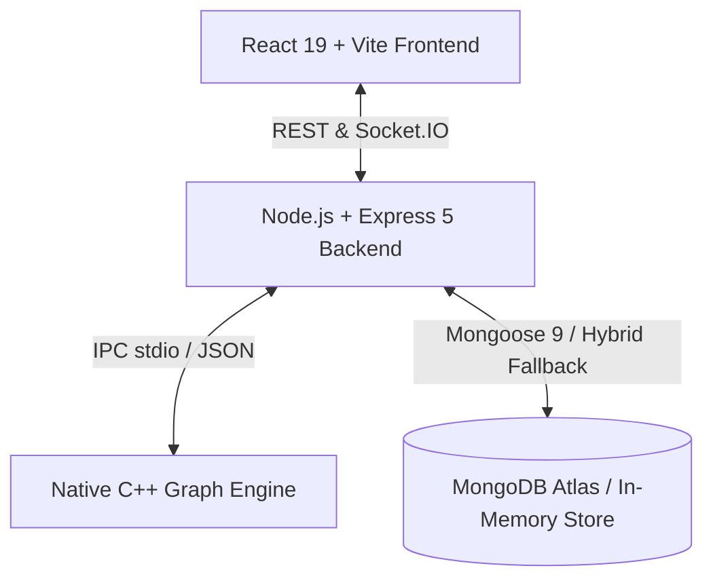

# 🔭 CodeScope

<p align="center">
  <strong>Intelligent Software-Module Dependency & Incremental Build Optimization Platform</strong>
</p>

<p align="center">
  
  
  
  
  
  
  
</p>

---

## 📖 Overview

**CodeScope** is a high-performance developer tool designed to analyze complex software module dependencies and determine the **smallest safe subset of modules that must be rebuilt following a code change**.

In enterprise monorepos and multi-service systems containing dozens or hundreds of interconnected modules, triggering a full rebuild on every change is costly and slow. CodeScope models software as a directed dependency graph, performs graph-traversal impact analysis, flags circular dependencies, and calculates topological build orders—demonstrating significant build time and compute reductions.

---

## ✨ Core Features

- 🔍 **Impact Analysis (BFS/DFS Traversal):** Select modified modules and instantly trace all forward transitive dependencies that require rebuilding.
- 📐 **Topological Build Planning (Kahn's Algorithm):** Generates guaranteed dependency-safe build sequences so upstream services are built before their dependents.
- 🔄 **Cycle Detection:** Identifies circular dependencies that break topological order and cause build deadlocks.
- 🕸️ **Interactive React Flow Graph:** Visual exploration of services, core utilities, and directional dependencies with zoom, pan, and live highlighting.
- 📊 **Real-time Performance Benchmarking:** Compares full baseline rebuild times against CodeScope incremental plans, displaying rebuild reduction percentages.
- ⚡ **High-Performance C++ Graph Engine:** Offloads compute-intensive graph algorithms (topological sort, cycles, transitive closure) to a native C++ executable.
- 🛡️ **Resilient Hybrid Architecture:** Built-in JWT authentication with automatic fallback to an in-memory data store when MongoDB is offline or unwhitelisted.

---

## 🏗️ Architecture & Tech Stack



- **Frontend:** React 19, Vite, React Flow (`@xyflow/react`), Dagre layout, Lucide Icons, React Router 7, Axios, React Hot Toast.
- **Backend:** Node.js, Express 5, JWT (`jsonwebtoken`), Bcrypt.js, Helmet, Rate Limiter, Socket.IO.
- **Algorithms / Engine:** C++17 (`GraphEngine.cpp`), Kahn's Algorithm, Depth-First Search Cycle Detection, nlohmann/json.
- **Database:** MongoDB / Mongoose with resilient in-memory fallback.

---

## 🚀 Quick Start Guide

### Prerequisites
- **Node.js** (v18 or higher recommended)
- **npm** (v9 or higher)
- *(Optional)* **g++ (MinGW on Windows)**: only needed if you modify the C++ engine source. A pre-compiled `GraphEngine.exe` is already included for Windows.

---

### 1. Clone & Install

```bash
git clone https://github.com/abhijeetpaul57/CodeScope.git
cd CodeScope

# Install all dependencies across root, server, and client:
npm run install:all
```

---

### 2. Environment Configuration

Copy the example environment files:

```bash
# Server configuration
cp server/.env.example server/.env

# Client configuration
cp client/.env.example client/.env
```

**`server/.env` contents:**
```env
PORT=5000
MONGO_URI=mongodb://localhost:27017/codescope
JWT_SECRET=codescope_jwt_secret_key_change_in_production
```

> **Note on MongoDB:** If MongoDB is running locally or configured via Atlas, CodeScope connects directly. If MongoDB is not reachable or your IP is not whitelisted, CodeScope automatically operates in **Resilient In-Memory Mode** so all features and authentication work seamlessly out of the box!

---

### 3. Run the Development Server

Start both the backend server and frontend client concurrently with a single command:

```bash
npm run dev
```

- 🌐 **Frontend UI:** [http://localhost:5173](http://localhost:5173)
- 🔌 **Backend API:** [http://localhost:5000](http://localhost:5000)

---

## 🔑 Demo Account & Instant Testing

For immediate testing, use the pre-configured demo account or click the **"⚡ Quick Demo Login"** button on the login screen:

- **Email:** `demo@codescope.io`
- **Password:** `password123`

You can also register any new account directly in the UI.

Once logged in, click **"Seed E-commerce Demo"** on the Projects page to populate a 12-module microservice architecture with 18 dependencies.

---

## 📁 Repository Structure

```text
CodeScope/
├── client/                     # React 19 + Vite Frontend
│   ├── src/
│   │   ├── components/         # Layout, Navbar, Topbar, Modals
│   │   ├── context/            # AuthContext, ProjectContext, AnalysisContext
│   │   ├── pages/              # Dashboard, Projects, Graph, Analysis, Benchmarks
│   │   ├── services/           # Axios API client and Socket.IO client
│   │   ├── App.jsx             # Protected routing
│   │   └── main.jsx
│   ├── package.json
│   └── vite.config.js
├── server/                     # Node.js + Express 5 Backend
│   ├── src/
│   │   ├── config/             # Database connection & Atlas lifecycle
│   │   ├── controllers/        # Auth, Projects, Modules, Graph, Engine analysis
│   │   ├── middleware/         # JWT auth middleware
│   │   ├── models/             # Mongoose schemas (User, Project, Module, etc.)
│   │   ├── routes/             # REST route definitions
│   │   ├── services/           # C++ Engine IPC bridge & fallback store
│   │   ├── sockets/            # Socket.io event handlers
│   │   ├── utils/              # Database seeding scripts
│   │   ├── app.js              # Express app setup
│   │   └── server.js           # Server entry point
│   ├── package.json
│   └── .env.example
├── engine/                     # C++ High-Performance Graph Engine
│   └── src/
│       ├── GraphEngine.cpp     # Kahn's Topo Sort, BFS impact, Cycle detection
│       ├── GraphEngine.exe     # Pre-compiled Windows binary
│       └── json.hpp            # nlohmann JSON header
├── docs/                       # Specifications & Technical Documentation
│   └── PRD_Technical_Design.md # Full PRD & architecture specification
├── package.json                # Root monorepo script coordinator
├── .gitignore
└── README.md
```

---

## 🛠️ Recompiling the C++ Engine (Optional)

If you modify `GraphEngine.cpp` or run on Linux/macOS:

```bash
cd engine/src

# On Windows (MinGW):
g++ -O3 -std=c++17 GraphEngine.cpp -o GraphEngine.exe

# On Linux / macOS:
g++ -O3 -std=c++17 GraphEngine.cpp -o GraphEngine
```

---

## 📡 Key REST API Endpoints

| Method | Endpoint | Description | Auth Required |
|---|---|---|---|
| `POST` | `/api/auth/register` | Register a new user | No |
| `POST` | `/api/auth/login` | Login user & receive JWT token | No |
| `GET` | `/api/auth/me` | Fetch authenticated user profile | Yes |
| `GET` | `/api/projects` | List all user projects | Yes |
| `POST` | `/api/projects` | Create a new project | Yes |
| `POST` | `/api/projects/seed` | Seed default 12-module E-commerce demo | Yes |
| `GET` | `/api/projects/:id/graph` | Fetch graph nodes and edges | Yes |
| `POST` | `/api/projects/:id/analysis` | Run C++ impact analysis on changed modules | Yes |
| `POST` | `/api/projects/:id/build-plan` | Generate Kahn's topological build sequence | Yes |
| `POST` | `/api/projects/:id/benchmarks` | Compare baseline vs optimized build metrics | Yes |

---

## 📄 License

This project is licensed under the [ISC License](LICENSE).
